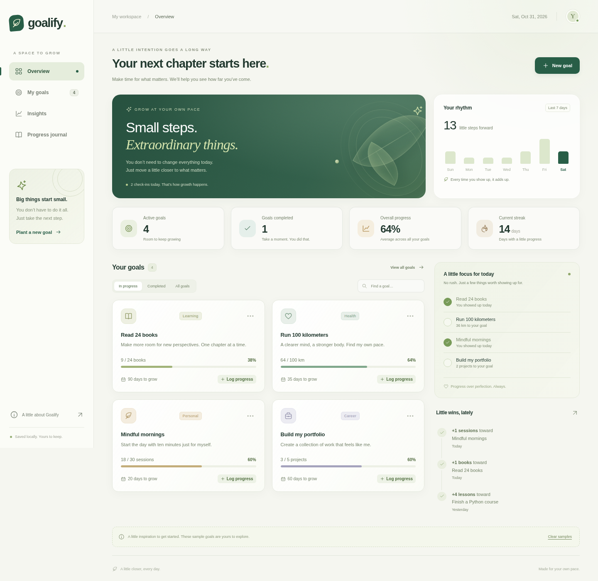
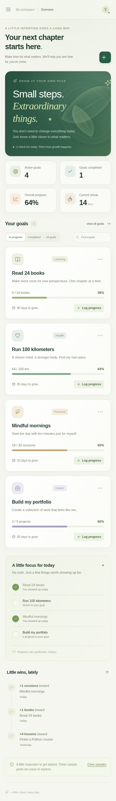

# Goalify

**A Smart Goal & Progress Tracker.**

Set goals. Build habits. Track progress. Become better every day.

Turn your intentions into small, measurable steps. Goalify brings your goals, daily check-ins, and progress together in a calm, liquid-glass interface, powered by Python and SQLite.



*Your goals, your rhythm, and your little wins—all in one place. Preview shown with sample goals.*

<details>
<summary>See the mobile layout</summary>



</details>

## What you can do

- **Set meaningful goals.** Choose a target, a category, and an optional date. Add a personal reason to remember why you started.
- **Build consistent habits.** Log regular check-ins and grow your streak, one day at a time.
- **See your progress.** Follow completion bars, weekly activity, and insights across different parts of your life.
- **Remember the small wins.** Leave a reflection with each check-in and revisit your progress journal.
- **Make room for change.** Edit goals, undo check-ins, and export your goals and journal as JSON.

## Getting started

### Prerequisites

- **[uv](https://docs.astral.sh/uv/getting-started/installation/)** — manages Python environments and installs the app's dependencies.
- **Python 3.10 or newer** — the runtime used by Goalify. `uv` can download a compatible Python version if needed.

Open a terminal in the `goalify` project folder, then follow these steps.

### 1. Create a virtual environment

Keep the app's dependencies separate from your other Python projects.

```sh
uv venv
```

### 2. Activate the environment

On **Linux or macOS**:

```sh
source .venv/bin/activate
```

On **Windows PowerShell**:

```powershell
.venv\Scripts\Activate.ps1
```

### 3. Install dependencies

Install the versions recorded in `uv.lock`, including the `app` command.

```sh
uv sync --locked
```

### 4. Start Goalify

```sh
uv run app
```

Open **[http://127.0.0.1:5050](http://127.0.0.1:5050)** in your browser. Keep the terminal running while you use the app; press `Ctrl+C` to stop it.

## Make it yours

The first launch includes labeled sample goals so you can explore the app. Choose **Clear samples** when you are ready for a fresh workspace. Goals you create are kept, and restarting the app never brings deleted samples back.

To start a new database without samples on its first launch:

```sh
uv run app --empty
```

If port `5050` is already in use, choose another:

```sh
uv run app --port 5051
```

Then open [http://127.0.0.1:5051](http://127.0.0.1:5051).

## Your data stays local

Goals and check-ins are saved in `instance/goalify.sqlite3`, which is excluded from Git. To back up your workspace, stop the app and copy this file. Set `GOALIFY_DATABASE` to use another database path.

Use **Export JSON** in the progress journal to keep a readable copy of your goals and entries. JSON import is not available in this version.

Goalify currently runs as a single-user local app, with no account or cloud sync. Check-ins use your computer's local date. Your streak counts consecutive days with a check-in, through today or yesterday if you have not logged today. Overall progress is the equally weighted average of all goals, including completed goals.

## Built with Python, ready to grow

Flask serves the app, SQLite stores your progress, and HTML, CSS, and vanilla JavaScript provide the interface. No frontend build step is needed.

The goal service is independent of Flask. A future Python desktop app can reuse it directly; a mobile client can use the JSON API after authentication and production hosting are added. The included server is for local development.

```text
goalify/cli.py               The app command
goalify/service.py           Goal logic and SQLite storage
goalify/__init__.py          Flask app and JSON API
goalify/templates/           Page layout
goalify/static/              Styles, interactions, and icon
docs/images/                Saved screenshots for this README
tests/                      API and browser checks
pyproject.toml              Project configuration and dependencies
uv.lock                     Locked dependency versions
```

To add a runtime dependency, use `uv add <package>`.

## Run the checks

The automated tests use temporary databases to check saving, completion, undo, validation, streaks, and sample cleanup.

```sh
uv run python -m unittest discover -s tests -v
```

For browser checks, including desktop and mobile layouts:

```sh
uv run --group browser python tests/browser_check.py
```

These checks use an isolated database and an existing Chrome installation. Set `GOALIFY_CHROME` if the executable is not on your PATH, or install a test browser with `uv run --group browser playwright install chromium`. Test screenshots are written to `test-results/`; the README screenshots are kept separately in `docs/images/`.
